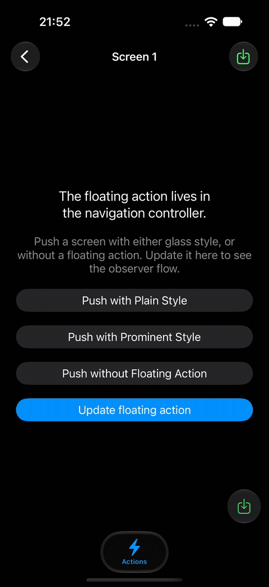

# FloatingAction

FloatingAction adds a prominent trailing action button to UIKit navigation flows. Each view controller can provide a `FloatingActionItem`; the button updates as navigation moves between screens.



## Requirements

- iOS 16 or later
- Swift 6.4 or later

## Testing

Run the test suite with Xcode's iOS Simulator destination from the package root:

```sh
xcodebuild test \
  -scheme FloatingAction \
  -destination 'platform=iOS Simulator,name=iPhone 17 Pro'
```

Replace `iPhone 17 Pro` with an installed simulator model if needed. List available destinations with:

```sh
xcodebuild -scheme FloatingAction -showdestinations
```

## Installation

In Xcode, choose **File → Add Package Dependencies**, enter `https://github.com/noppefoxwolf/FloatingAction`, and add the `FloatingAction` product to your app target.

## License

FloatingAction is available under the MIT license. See [LICENSE](LICENSE) for details.

## Usage

Set the action on the view controller that should display it:

```swift
import FloatingAction
import UIKit

final class SaveViewController: UIViewController {
    override func viewDidLoad() {
        super.viewDidLoad()

        floatingItem.trailingItem = FloatingActionItem(
            identifier: "save",
            action: UIAction(
                title: "Save",
                image: UIImage(systemName: "square.and.arrow.down")
            ) { [weak self] _ in
                self?.saveDocument()
            },
            menu: UIMenu(children: [
                UIAction(title: "Save a Copy", image: UIImage(systemName: "doc.on.doc")) { [weak self] _ in
                    self?.saveDocumentCopy()
                }
            ])
        )
    }

    private func saveDocument() {}
    private func saveDocumentCopy() {}
}
```

Use `FloatingActionNavigationController` as the navigation controller. Forward `willShow` to `handleWillShow(_:animated:)` to animate the floating action alongside the navigation bar, and forward `didShow` to `handleDidShow(_:animated:)` to finalize the visible item and remove stale buttons. See [Example.swiftpm](Example.swiftpm) for a complete setup.

Set the trailing action with `floatingItem.trailingItem`:

```swift
floatingItem.trailingItem = saveAction
```

`floatingItem` is available before the view controller is added to a navigation controller, so you can configure it in your view controller's initializer. Each view controller keeps the same `FloatingItem` instance for its lifetime.

## Behavior

- Displays one prominent action at the trailing edge of the safe area.
- Uses the system glass appearance on iOS 26 and later, and a prominent capsule button on earlier supported versions.
- Supports `UIAction`, `UIMenu`, visibility, title, image, and tint updates for the item.
- Leaves title, image, and tint unspecified by default so the item doesn't impose fallback content or color.
- Matches actions across screens by `identifier` during navigation.
- Lets each `FloatingActionNavigationController` hide its button with `showsFloatingAction`.

In a split view, an app can hide the primary column's button while both columns are visible:

```swift
primaryNavigationController.showsFloatingAction = splitViewController.isCollapsed
```

The example app exposes this behavior through `showsOnlySecondaryFloatingAction` on its split view controller.

